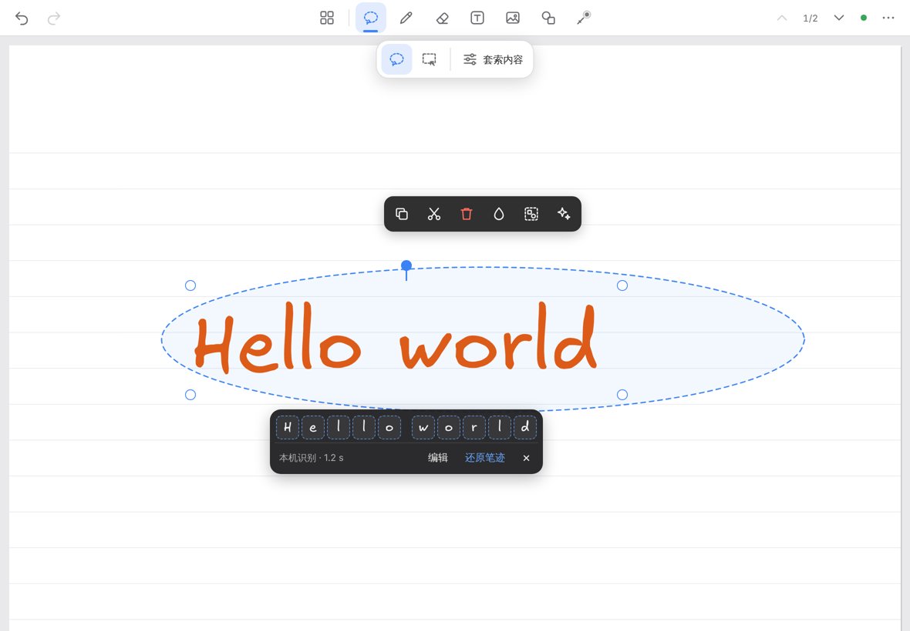

# HandNote

Handwritten notebook pages for [Obsidian](https://obsidian.md), made for the Apple Pencil and
working with touch and mouse. Write with pressure-sensitive pens, select with a lasso, and convert
handwriting into editable text — on your device, without an account or API key. Formulas are
edited as LaTeX.

[中文说明](README.zh-CN.md)

> HandNote is an independent, third-party community plugin. It is not made by, affiliated with or
> endorsed by Obsidian, MyScript, Goodnotes, Xmind or Excalidraw.

## Features

- **Notebook pages** in `.handnote` files: A4 / A5 / A3 / Letter, blank, ruled, grid or dotted
  paper, many pages per note, a page sidebar to reorder pages. Embed a note in Markdown with
  `![[My note.handnote]]`.
- **Pens**: fountain pen with real Apple Pencil pressure, pencil, highlighter, dashed and dotted
  strokes, shape pen (lines, arrows, circles, rectangles are recognised as you draw), laser
  pointer.
- **Eraser**: precise, partial or whole-stroke; highlighter-only.
- **Objects**: text boxes, images (vault attachments or embedded), shapes and connectors, editable
  formulas, mind maps.
- **Lasso**: free-form or rectangular. Move, resize, rotate, copy, cut, recolour, group. A loop
  around part of a text picks just those characters.
- **Convert handwriting** (lasso → Convert):
  - **Text** (Chinese and English), in place, one undo step, with "Restore ink" and candidates for
    uncertain characters. Recognition runs **on your device** after a one-time model download.
  - **Math**: this version has **no on-device math recognition**. Convert → Math lets you type the
    formula as LaTeX (with a live preview; the ink is kept or replaced, as you choose), or recognise
    it with MyScript (your own keys).
  - Formulas can be edited, moved, resized, copied and copied as Markdown (`$$…$$`).
- **AI tools** (optional, your own provider key): turn a sketch into a mind map or a flowchart, read
  text from a picture.
- **Safe storage**: every save checks that the file was not changed by sync first; a recovery
  journal and backups protect unsaved strokes; damaged or newer-format notes open read-only and are
  never overwritten.

## Platforms

| Platform | Status |
|---|---|
| iPad (Obsidian for iPadOS) with Apple Pencil | Primary target. Pressure, 240 Hz Pencil input, palm rejection, finger pan / pinch, two-finger undo. |
| Windows / macOS / Linux desktop | Mouse, pen tablet, touch screen, keyboard shortcuts. |
| iPhone / Android | Should work (no Node or Electron APIs are used), but is not tested. |

Minimum Obsidian version: 1.11.4 (secret storage for the optional API keys).

## Writing

| Action | Pencil / pen | Finger | Mouse / keyboard |
|---|---|---|---|
| Write | draw | — (unless "finger drawing" is on) | drag |
| Pan / zoom | — | one-finger drag / pinch | space + drag, Ctrl + wheel |
| Undo / redo | — | two- / three-finger tap | Ctrl+Z / Ctrl+Shift+Z |
| Edit a text | tap it (lasso or text tool) | tap it | click it (lasso or text tool) |
| Pen ⇄ eraser | — | double-tap with one finger | 1 / E |

## Lasso and conversion

1. Pick the lasso and draw a loop around handwriting. The loop stays as the outline of the
   selection.
2. Tap **Convert → Text**. The handwriting is replaced in place by editable text, about as large as
   you wrote it. **Convert → Math** opens the LaTeX editor (or uses MyScript, if you set it up).
3. The result stays selected: drag it, tap it to type, pick another candidate in the bar below it,
   or press **Restore ink**.

## On-device recognition and model downloads

Settings → HandNote → **Local recognition**. The recognition runtime (ONNX Runtime Web 1.24.2, MIT)
is **built into the plugin**; it is never downloaded and starts only when you convert. The
recognition **models are not built in**: each one is downloaded separately, and only when you ask.

| Pack | Download size | Downloaded from (first mirror that answers) | Used for | Licence of the files |
|---|---|---|---|---|
| Chinese text — PaddleOCR PP-OCRv5 mobile rec (ONNX) + dictionary | 15.8 MB | PaddleOCR's official download (Baidu, paddle-model-ecology.bj.bcebos.com), Hugging Face `PaddlePaddle/PP-OCRv5_mobile_rec_onnx` (or hf-mirror.com); dictionary from the PaddleOCR GitHub repository (or its jsDelivr copy) | Chinese and mixed lines | Apache-2.0 (model card) |
| English text — PaddleOCR en_PP-OCRv5 mobile rec (ONNX) + dictionary | 7.5 MB | as above (`en_PP-OCRv5_mobile_rec_onnx`) | English lines | Apache-2.0 (model card) |
| Hand font — Excalifont + Xiaolai (optional) | up to 12.1 MB, loaded per character | Excalidraw's npm package / repository (npmmirror, jsDelivr, GitHub, Fastly) | hand-lettered look for converted text | SIL OFL 1.1 |

- **When:** only after you press a pack's **Download** button in Local recognition, or accept the
  offer shown when you convert without the model. The size is shown first. Nothing is downloaded at
  startup, on install, on update or in the background.
- **Checked:** every file has a fixed size and SHA-256 in the plugin; a file that does not match is
  discarded. There is no automatic model update: new models only come with a new plugin version, and
  you still press the button.
- **Stored:** in this device's app storage (IndexedDB, per device). Never in your vault, never
  synced. Uninstalling HandNote does not delete them; delete them in Local recognition first.
- **Uploaded:** nothing. The download requests are plain file requests (short HEAD requests first to
  find a mirror that answers). Your notes and your handwriting never leave the device for local
  recognition.
- **Offline:** after the download, recognition works without a connection. Without the models,
  writing and everything else still works; Convert → Text can use the built-in offline Chinese
  engine.
- Blocked mirrors: **Import files** accepts the same files from disk (same hash check). **Run
  self-test** shows what works on this device and which mirrors answer.
- Local recognition needs iPadOS / iOS 16.4 or newer on mobile devices (older systems can use
  MyScript).

## Optional cloud services

Nothing is sent anywhere unless you set it up yourself:

- **MyScript** (Settings → HandNote → Recognition): enter your own MyScript keys. The strokes of a
  selection are sent to MyScript after a confirmation. MyScript's terms and pricing apply.
- **AI providers** (Settings → HandNote → AI): OpenAI, Anthropic, Google Gemini, DeepSeek, Alibaba
  Cloud Qwen, or any OpenAI-compatible endpoint, with your own key. A picture of the selection is
  sent after a confirmation. The provider's pricing applies.

Keys are kept in Obsidian's secret storage, never in settings files or notes.

## Privacy

No telemetry, no analytics, no account, no server of its own. The full list of network requests —
service, purpose, data sent, cost, offline behaviour — is in [PRIVACY.md](PRIVACY.md).

## Installation

From Obsidian: Settings → Community plugins → Browse → search "HandNote" → Install → Enable.

Manual: download `main.js`, `manifest.json` and `styles.css` from the
[latest release](../../releases/latest) into `<vault>/.obsidian/plugins/handnote/`, then enable
HandNote in Settings → Community plugins. Each release also has `SHA256SUMS.txt` to verify the files.

## FAQ

See [FAQ.md](FAQ.md). Short answers:

- *Where are my notes?* In `.handnote` files in your vault, synced by whatever you use (Obsidian
  Sync, iCloud, Remotely Save…).
- *The model download hangs.* Run the self-test to see which mirrors your network reaches. Use
  "Import files" if none does.
- *English recognition is weak.* Install the English pack. Lines written in Latin script use it
  automatically.

## Known limitations

- **No on-device math recognition.** No handwritten-math model with clear licence terms is
  included yet. Type formulas as LaTeX, or use MyScript with your own keys. Notes with formulas made
  by any HandNote version open and edit normally.
- Handwriting recognition is trained on general handwriting: unusual handwriting, very small
  writing or mixed scripts in one line are read less reliably. Uncertain results are shown with
  candidates, and the ink is kept until you choose.
- A note made with a newer HandNote opens read-only in an older one. Update HandNote on every
  device that edits the same notes.
- Phone layouts are not optimised.
- `main.js` is about 5.9 MB because the recognition runtime is built in. Obsidian Sync's Standard
  plan does not sync files over 5 MB, so with that plan install HandNote on each device from
  Community plugins (your notes sync as usual).

## Feedback

Bugs and ideas: [issues](../../issues) (please do not attach private notes or keys). Security
problems: see [SECURITY.md](SECURITY.md).

## Licence

HandNote's own code: [MIT](LICENSE). Parts made by others keep their own licences and are **not**
covered by HandNote's licence: ONNX Runtime Web inside `main.js` (MIT, © Microsoft Corporation),
the Chinese stroke data inside `main.js` (Arphic Public License, `vendor/hanzi-mmah/`), and the
optional downloads (Apache-2.0, SIL OFL 1.1). Details and licence texts:
[THIRD_PARTY_NOTICES.md](THIRD_PARTY_NOTICES.md).
