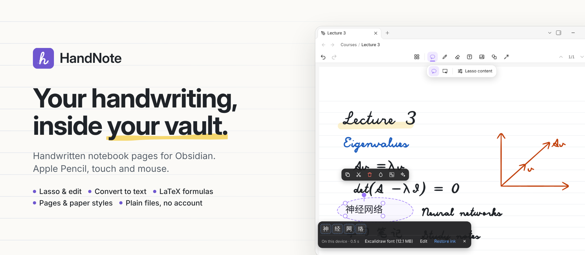

<picture>
  <source media="(prefers-color-scheme: dark)" srcset="https://raw.githubusercontent.com/Pilgrimagecoding/obsidian-handnote-public/HEAD/assets/branding/hero-dark.png">
  
</picture>

**HandNote** adds handwritten notebook pages to [Obsidian](https://obsidian.md). Write with an
Apple Pencil, a finger or a mouse, select with a lasso, turn handwriting into editable text on your
device, and keep every page as a plain `.handnote` file in your vault.

**[Install from the Obsidian community directory](https://community.obsidian.md/plugins/handnote)** ·
[Releases](https://github.com/Pilgrimagecoding/obsidian-handnote-public/releases) ·
[中文说明](README.zh-CN.md)

## Write like on paper

Pressure-sensitive fountain pen, pencil, highlighter, dashed strokes, a shape pen that straightens
lines, arrows, circles and rectangles, and a laser pointer. Pages come in A4, A5, A3 or Letter with
blank, ruled, grid or dotted paper.

## Lasso, then convert to text

Draw a loop around handwriting and choose **Convert → Text**. The ink is replaced in place by
editable text (Chinese and English), in one undo step, with candidates for uncertain characters and
a **Restore ink** button. Recognition runs **on your device**: the runtime is built into the
plugin, and the text models are downloaded once, when you ask ([details](#on-device-recognition-and-model-downloads)).

## Annotate PDF, Word, PowerPoint and Excel

**Import document…** (command palette or the editor menu), or right-click a file in the file list
→ **Annotate in HandNote**. Every page of the document becomes a HandNote page of the same size, and
you write on it like on any other page.

- **PDF** — rendered by the PDF engine that comes with Obsidian.
- **Word** (.docx, and older .doc) — headings, styles, lists, tables, pictures and landscape
  sections, laid out into fixed pages.
- **PowerPoint** (.pptx) — one page per slide: backgrounds, shapes, text, pictures, groups, tables.
- **Excel** (.xlsx) — printed on A4 pages like OneNote, cells at their real size, number formats,
  fills, borders and merged cells. Formulas show the value saved in the file; HandNote does not
  recalculate.

The original file is kept unmodified in your vault (folder `HandNote imports` by default) and the
note stores only a reference plus your ink. Macros never run, nothing is uploaded. What a file
contains that HandNote cannot show (charts, animations, footnotes…) is listed when you import it.

## Formulas as LaTeX

**Convert → Math** opens a LaTeX editor with a live preview: type the formula, then insert it next
to your handwriting or replace the ink. Formulas stay editable objects you can move, resize and copy
as Markdown (`$$…$$`). Handwritten-math recognition is available through MyScript with your own
keys; this plugin has no on-device math recognition.

## Pages, paper and objects

Many pages per note, reordered in the page sidebar. Text boxes, images, shapes with connectors and
editable formulas sit on the page with your ink; the lasso moves, resizes, rotates, recolours and
groups any of them. Long-press the page with a finger (right-click on desktop) to paste, add a text
box or insert an image right there.

## Plain files in your vault

Every note is a `.handnote` file in your vault, synced by whatever you already use. Embed a page in
any Markdown note with `![[Lecture 3.handnote]]`. No account, no server of its own. Saving is
careful: it checks the file was not changed by sync first, keeps a recovery journal and backups,
and opens damaged or newer-format files read-only.

## Get started

1. In Obsidian: **Settings → Community plugins → Browse**, search for **HandNote**, then
   **Install** and **Enable**. (Or open the [directory page](https://community.obsidian.md/plugins/handnote)
   and press **Add to Obsidian**.)
2. Create a note: the **New handwritten note** command, or right-click a folder → **New HandNote**.
3. Write. Pick the lasso, circle a few words, press **Convert → Text**. The first time, HandNote
   offers to download the text model (size shown first); Chinese also works with the built-in
   offline engine, without any download.

Manual install: copy `main.js`, `manifest.json` and `styles.css` from the
[latest release](https://github.com/Pilgrimagecoding/obsidian-handnote-public/releases/latest) into
`<vault>/.obsidian/plugins/handnote/` and enable HandNote. The SHA-256 of each file is in the
release notes, and releases carry GitHub build-provenance attestations.

## Platforms

| Platform | Status |
|---|---|
| iPad (Obsidian for iPadOS) with Apple Pencil | Primary target: pressure, palm rejection, finger pan / pinch, two-finger undo |
| Windows / macOS / Linux | Mouse, pen tablet, touch screen, keyboard shortcuts |
| iPhone / Android | Should work (no desktop-only APIs are used) but is not tested |

Requires Obsidian 1.11.4 or newer. On-device recognition on iPad / iPhone needs iPadOS / iOS 16.4
or newer.

<strong>Gestures and shortcuts</strong>

| Action | Pencil / pen | Finger | Mouse / keyboard |
|---|---|---|---|
| Write | draw | — (unless "finger drawing" is on) | drag |
| Pan / zoom | — | one-finger drag / pinch | space + drag, Ctrl + wheel |
| Undo / redo | — | two- / three-finger tap | Ctrl+Z / Ctrl+Shift+Z |
| Edit a text | tap it (lasso or text tool) | tap it | click it (lasso or text tool) |
| Pen ⇄ eraser | — | double-tap with one finger | 1 / E |
| Paste / add here | — | long-press the page | right-click, Ctrl+V |

## On-device recognition and model downloads

Settings → HandNote → **Local recognition**. The recognition runtime (ONNX Runtime Web 1.24.2, MIT)
is **built into the plugin**; it is never downloaded and starts only when you convert. The
recognition **models are not built in**: each one is downloaded separately, and only when you ask.

| Pack | Size | Downloaded from (first mirror that answers) | Used for | Licence |
|---|---|---|---|---|
| Chinese text — PaddleOCR PP-OCRv5 mobile rec (ONNX) + dictionary | 15.8 MB | PaddleOCR's official download (Baidu, paddle-model-ecology.bj.bcebos.com), Hugging Face `PaddlePaddle/PP-OCRv5_mobile_rec_onnx` (or hf-mirror.com); dictionary from the PaddleOCR GitHub repository (or its jsDelivr copy) | Chinese and mixed lines | Apache-2.0 (model card) |
| English text — PaddleOCR en_PP-OCRv5 mobile rec (ONNX) + dictionary | 7.5 MB | as above (`en_PP-OCRv5_mobile_rec_onnx`) | English lines | Apache-2.0 (model card) |
| Hand font — Excalifont + Xiaolai (optional) | up to 12.1 MB, loaded per character | Excalidraw's npm package / repository (npmmirror, jsDelivr, GitHub, Fastly) | hand-lettered look for converted text | SIL OFL 1.1 |

- **When:** only after you press a pack's **Download** button in Local recognition, or accept the
  offer shown when you convert without the model. The size is shown first. Nothing is downloaded at
  startup, on install, on update or in the background.
- **Checked:** every file has a fixed size and SHA-256 in the plugin; a file that does not match is
  discarded. There is no automatic model update: new models only come with a new plugin version, and
  you still press the button.
- **Stored:** in this device's app storage (IndexedDB, per device). Never in your vault, never
  synced. Uninstalling HandNote does not delete them; delete them in Local recognition first.
- **Uploaded:** nothing. The download requests are plain file requests (short HEAD requests first to
  find a mirror that answers). Your notes and your handwriting never leave the device for local
  recognition.
- **Offline:** after the download, recognition works without a connection. Without the models,
  writing and everything else still works; Convert → Text can use the built-in offline Chinese
  engine.
- Blocked mirrors: **Import files** accepts the same files from disk (same hash check). **Run
  self-test** shows what works on this device and which mirrors answer.

## Optional cloud services

Nothing is sent anywhere unless you set it up yourself:

- **MyScript** (Settings → HandNote → Recognition): your own MyScript keys. The strokes of a
  selection are sent to MyScript after a confirmation, for text or math. MyScript's terms and
  pricing apply.
- **AI providers** (Settings → HandNote → AI): OpenAI, Anthropic, Google Gemini, DeepSeek, Alibaba
  Cloud Qwen, or any OpenAI-compatible endpoint, with your own key — to turn a sketch into a mind
  map or a flowchart, or read text from a picture. A picture of the selection is sent after a
  confirmation. The provider's pricing applies.

Keys are kept in Obsidian's secret storage, never in settings files or notes.

## Privacy

No telemetry, no analytics, no account, no server of its own. Every network request — service,
purpose, data sent, cost, offline behaviour — is listed in [PRIVACY.md](PRIVACY.md).

## Known limitations

- **No on-device math recognition.** Type formulas as LaTeX, or use MyScript with your own keys.
  Notes with formulas made by any HandNote version open and edit normally.
- Recognition is trained on general handwriting: unusual or very small writing, or several scripts
  in one line, are read less reliably. Uncertain results come with candidates, and the ink is kept
  until you choose.
- A note made with a newer HandNote opens read-only in an older one. Update HandNote on every
  device that edits the same notes.
- Imported Word / PowerPoint / Excel files are re-laid out by HandNote, not by Microsoft Office:
  page breaks and fonts can differ slightly, and charts, SmartArt, animations, headers / footers and
  footnotes are not shown. Older .ppt / .xls must be saved as .pptx / .xlsx or PDF first. Office
  files get a small `.handnote-layout.json` beside them — let your sync tool sync it.
- Notes with imported pages use file format 6: HandNote 0.8.x opens them read-only.
- Phone layouts are not optimised.
- `main.js` is about 6.2 MB because the recognition runtime is built in. Obsidian Sync's Standard
  plan does not sync files over 5 MB, so with that plan install HandNote on each device from
  Community plugins (your notes sync as usual).

More answers: [FAQ.md](FAQ.md).

## Feedback

Bugs and ideas: [GitHub issues](https://github.com/Pilgrimagecoding/obsidian-handnote-public/issues)
(please do not attach private notes or keys). Security problems: [SECURITY.md](SECURITY.md).

## Licence

HandNote's own code: [MIT](LICENSE). Parts made by others keep their own licences and are **not**
covered by HandNote's licence: ONNX Runtime Web inside `main.js` (MIT, © Microsoft Corporation),
the Chinese stroke data inside `main.js` (Arphic Public License, `vendor/hanzi-mmah/`), and the
optional downloads (Apache-2.0, SIL OFL 1.1). Details and licence texts:
[THIRD_PARTY_NOTICES.md](THIRD_PARTY_NOTICES.md).

HandNote is an independent community plugin. It is not made by, affiliated with or endorsed by
Obsidian, MyScript, Goodnotes, Xmind, Excalidraw or Microsoft. Screenshots: Obsidian desktop with
HandNote 0.8.1 in a demo vault (the import screenshot: HandNote 0.9.0); the handwriting in them is
played back by a script.
