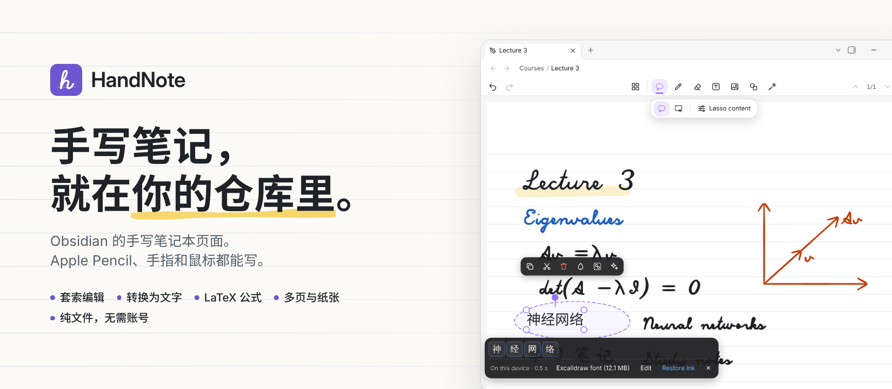
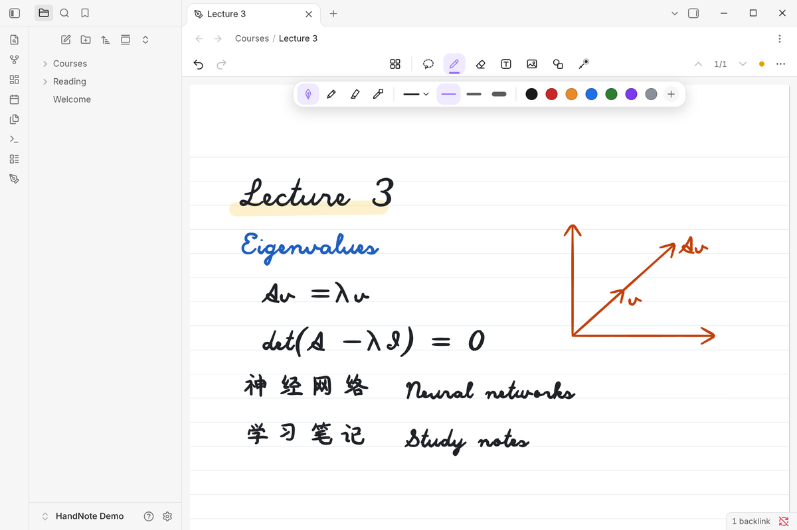
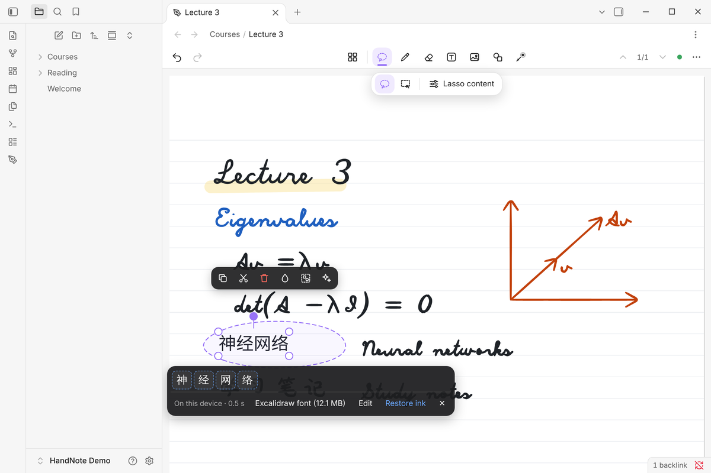
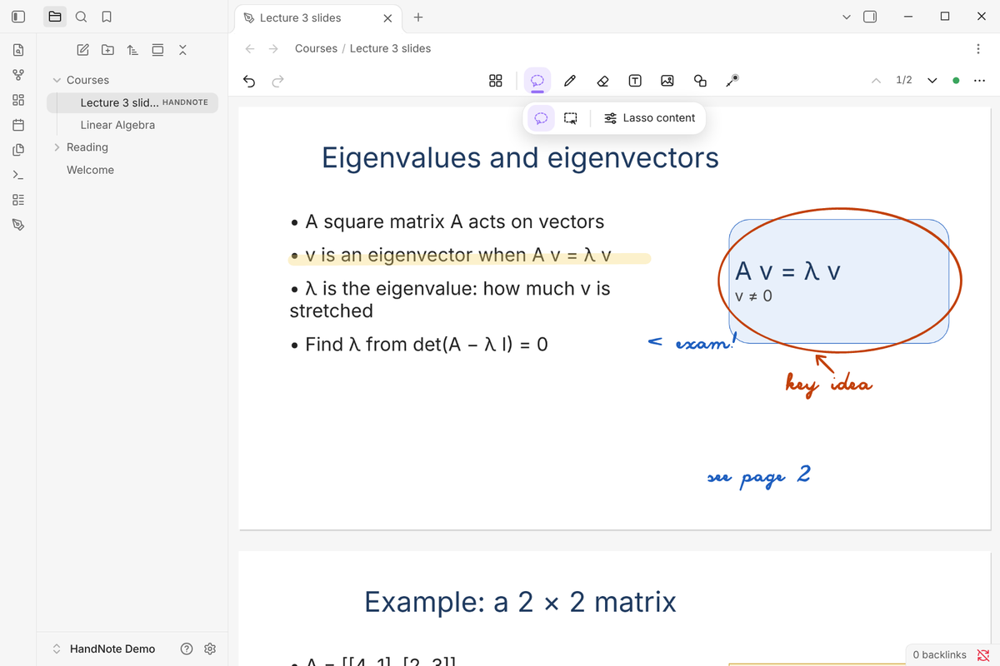
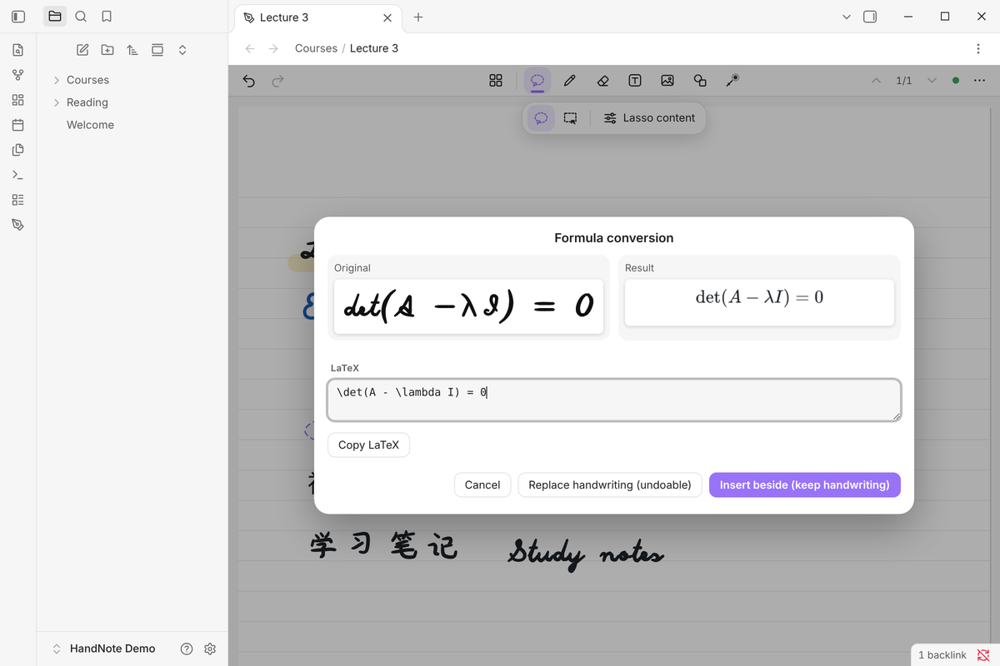
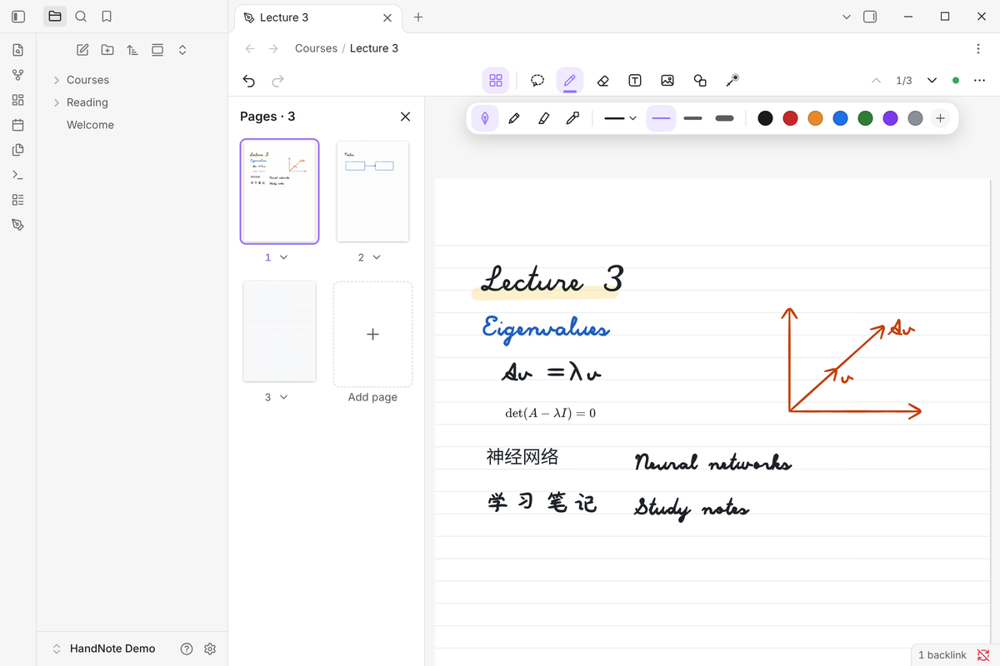
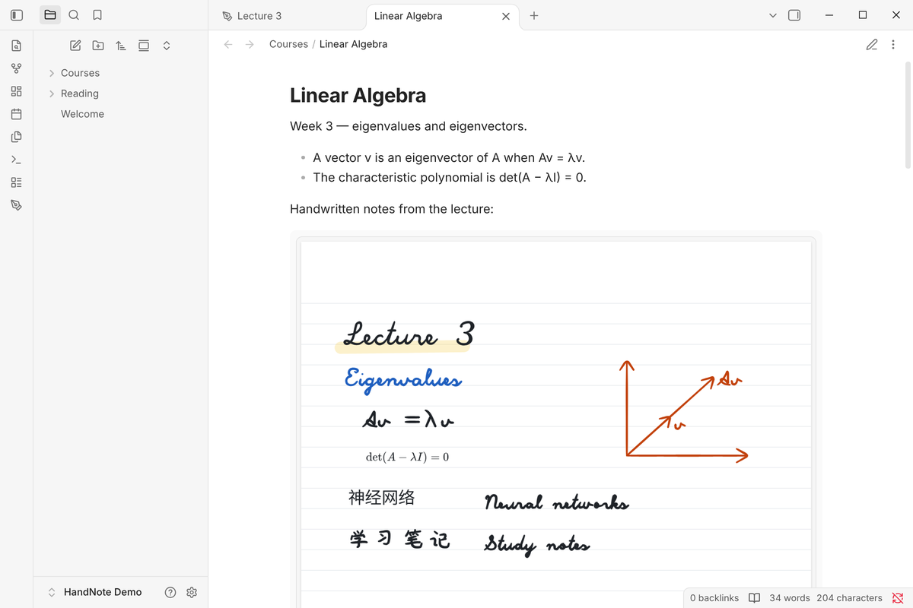

<picture>
  <source media="(prefers-color-scheme: dark)" srcset="https://raw.githubusercontent.com/Pilgrimagecoding/obsidian-handnote-public/HEAD/assets/branding/hero-zh-dark.png">
  
</picture>

**HandNote** 是 [Obsidian](https://obsidian.md) 的手写笔记插件，主要为 iPad 和 Apple Pencil 设计，也支持手指、鼠标和数位板。在笔记本页面上手写，用套索选择，在本机把手写转换成可编辑的文字，还可以导入 PDF、Word、PowerPoint、Excel 并手写批注。每一页都是你仓库（Vault）里的一个普通 `.handnote` 文件。免费开源（MIT 许可）。

**[从 Obsidian 社区插件目录安装](https://community.obsidian.md/plugins/handnote)** ·
[版本发布](https://github.com/Pilgrimagecoding/obsidian-handnote-public/releases) ·
**[中文教程](docs/zh-CN/README.md)** ·
[English](README.md)

## 一分钟了解

https://github.com/user-attachments/assets/b9c49b44-824b-40c1-82b0-6e2e1367528b

iPad 片段：用 Apple Pencil 实拍的 HandNote 0.8.1。桌面片段：已发布的 0.8.1 文件，笔迹由脚本回放（视频中有标注）。包含 0.9 文档导入和英文配音的完整版在 [YouTube](https://www.youtube.com/watch?v=XuCaMYtpDbQ)。

## 中文教程

[安装与配置](docs/zh-CN/install.md) · [iPad 与 Apple Pencil](docs/zh-CN/ipad-apple-pencil.md) · [手写转文字](docs/zh-CN/handwriting-to-text.md) · [文档导入与批注](docs/zh-CN/documents.md) · [公式](docs/zh-CN/formulas.md) · [常见问题](docs/zh-CN/faq.md) · [已知限制](docs/zh-CN/limitations.md)

## 像在纸上一样书写

压感钢笔、铅笔、荧光笔、虚线 / 点线，自动把直线、箭头、圆和矩形画规整的图形笔，以及激光笔。纸张有 A4、A5、A3、Letter，背景可选空白、横线、方格或点阵。

## 套索圈选，转换为文字

用套索圈住手写内容，点「转换 → 文字」。笔迹在原位被替换成可编辑的文字（中文和英文），一步即可撤销；不确定的字会给出候选，也可以「还原笔迹」。识别**在本机运行**：运行库内置在插件中，文字模型只在你要求时下载一次（[详情](#本机识别与模型下载)）。

## 批注 PDF、Word、PowerPoint 和 Excel

「导入文档…」（命令面板或编辑器菜单），或在文件列表里对文件右键 →「在 HandNote 中批注」。文档的每一页都会变成同样大小的 HandNote 页面，可以像普通页面一样书写。

- **PDF**：用 Obsidian 自带的 PDF 引擎渲染。
- **Word**（.docx 和旧版 .doc）：标题、样式、列表、表格、图片、横向分节，排成固定页面。
- **PowerPoint**（.pptx）：每张幻灯片一页，包括背景、形状、文字、图片、组合、表格。
- **Excel**（.xlsx）：像 OneNote 一样印在 A4 纸上，单元格保持原大小，显示数字格式、填充、边框、合并单元格。公式显示文件里保存的结果，HandNote 不会重新计算。

原文件原样保存在仓库里（默认 `HandNote imports` 文件夹），笔记只保存引用和你的笔迹。不运行宏，不上传任何文件。导入时会列出文件中无法显示的内容（图表、动画、脚注等）。

## 公式用 LaTeX

「转换 → 公式」会打开带实时预览的 LaTeX 编辑器：输入公式后，可以插入到手写旁边，或替换掉笔迹。公式是可编辑对象，可以移动、缩放，也可以复制为 Markdown（`$$…$$`）。手写公式识别可以通过 MyScript（你自己的密钥）完成；本插件不提供本机公式识别。

## 多页、纸张与对象

一篇笔记可以有很多页，在页面侧栏里拖动排序。文本框、图片、带连线的图形和可编辑公式与笔迹放在同一页上；套索可以移动、缩放、旋转、改色和编组它们。用手指长按页面（桌面版右键），可以在该位置粘贴、添加文本框或插入图片。

## 就是仓库里的普通文件

每篇笔记都是仓库里的一个 `.handnote` 文件，用你已有的同步方式同步。在任意 Markdown 笔记里用 `![[Lecture 3.handnote]]` 嵌入。不需要账号，插件也没有自己的服务器。保存很谨慎：先检查文件是否被同步工具改过，有恢复日志和备份，损坏的或由新版本创建的文件只读打开。

## 快速开始

1. 在 Obsidian 中：**设置 → 第三方插件 → 浏览**，搜索 **HandNote**，点 **安装**，再点 **启用**。（也可以打开[目录页面](https://community.obsidian.md/plugins/handnote)，点 **Add to Obsidian**。）
2. 新建笔记：运行命令 **New handwritten note**，或在文件夹上右键 → **新建 HandNote**。
3. 开始书写。选择套索，圈住几个字，点「转换 → 文字」。第一次转换时，HandNote 会提示下载文字模型（先显示大小）；中文也可以直接使用内置的离线引擎，无需下载。

手动安装：从[最新版本](https://github.com/Pilgrimagecoding/obsidian-handnote-public/releases/latest)下载 `main.js`、`manifest.json`、`styles.css`，放进 `<仓库>/.obsidian/plugins/handnote/`，然后启用 HandNote。每个文件的 SHA-256 写在版本说明里，版本还附有 GitHub 构建来源证明（attestation）。

## 平台支持

| 平台 | 状态 |
|---|---|
| iPad（Obsidian iPadOS 版）+ Apple Pencil | 主要目标平台：压感、防误触、手指平移和缩放、双指撤销 |
| Windows / macOS / Linux | 鼠标、数位板、触屏、快捷键 |
| iPhone / Android | 没有使用桌面专用接口，理论上可用，但未测试 |

需要 Obsidian 1.11.4 或更高版本。iPad / iPhone 上的本机识别需要 iPadOS / iOS 16.4 或更高版本。

## 快速回答

- **HandNote 是 Obsidian 插件吗？** 是。它收录在 Obsidian 官方社区插件目录（插件 ID `handnote`），由社区开发者独立开发，不是 Obsidian 官方出品。
- **支持 iPad 和 Apple Pencil 吗？** 支持，这是主要目标平台：压感、防误触，手指平移、缩放和撤销。
- **能把手写转成文字吗？** 能，中文和英文，在本机识别；第一次需要下载模型（中文 15.8 MB、英文 7.5 MB）。内置的离线中文识别不需要下载，适合工整中文。
- **能批注文档吗？** 能，从 0.9.0 起支持 PDF、Word（.docx、.doc）、PowerPoint（.pptx）和 Excel（.xlsx）。原文件不会被修改，也不会上传。
- **有本机手写公式识别吗？** 没有。可以用带实时预览的 LaTeX 输入公式，或用你自己的 MyScript 密钥。
- **免费吗？** 免费，MIT 开源，没有账号、订阅和遥测。可选的云服务使用你自己的密钥。

<strong>手势与快捷键</strong>

| 操作 | Pencil / 笔 | 手指 | 鼠标 / 键盘 |
|---|---|---|---|
| 书写 | 直接写 | —（除非打开「手指书写」） | 拖动 |
| 平移 / 缩放 | 电脑数位板：空格 + 拖动，或把笔的侧键设为中键 | 单指拖动 / 双指捏合 | 空格 + 拖动，Ctrl + 滚轮 |
| 撤销 / 重做 | — | 双指 / 三指轻点 | Ctrl+Z / Ctrl+Shift+Z |
| 编辑文字 | 轻点它（套索或文字工具） | 轻点它 | 单击它（套索或文字工具） |
| 笔 ⇄ 橡皮 | — | 单指双击 | 1 / E |
| 粘贴 / 在此添加 | — | 长按页面 | 右键、Ctrl+V |

## 本机识别与模型下载

位置：设置 → HandNote → 本地识别。识别运行库（ONNX Runtime Web 1.24.2，MIT）**已内置在插件中**，不会下载，只在转换时启动。**识别模型不内置**：每个模型单独下载，并且只在你要求时下载。

| 识别包 | 下载大小 | 下载来源（先用能连上的镜像） | 用途 | 文件的许可 |
|---|---|---|---|---|
| 中文文字：PaddleOCR PP-OCRv5 mobile rec（ONNX）+ 字典 | 15.8 MB | PaddleOCR 官方下载（百度 paddle-model-ecology.bj.bcebos.com）、Hugging Face `PaddlePaddle/PP-OCRv5_mobile_rec_onnx`（或 hf-mirror.com）；字典来自 PaddleOCR 的 GitHub 仓库（或其 jsDelivr 副本） | 中文和中英混合 | Apache-2.0（模型卡） |
| 英文文字：PaddleOCR en_PP-OCRv5 mobile rec（ONNX）+ 字典 | 7.5 MB | 同上（`en_PP-OCRv5_mobile_rec_onnx`） | 英文行 | Apache-2.0（模型卡） |
| 手写字体：Excalifont + 小赖（可选） | 最多 12.1 MB，按字符加载 | Excalidraw 的 npm 包 / 仓库（npmmirror、jsDelivr、GitHub、Fastly） | 转换后文字的手写风格 | SIL OFL 1.1 |

- **何时下载**：只有在「本地识别」里点某个包的「下载」，或者转换时在提示里确认下载，才会下载；下载前先显示大小。启动、安装、更新时都不会在后台下载。
- **校验**：每个文件的大小和 SHA-256 都固定写在插件里，不一致就丢弃。模型不会自动更新：新模型只随新版插件提供，而且仍需你点击下载。
- **存放位置**：本设备的应用存储（IndexedDB，按设备）。不放进仓库，不会被同步。卸载插件不会删除模型，如需释放空间，请先在「本地识别」里删除。
- **是否上传**：不上传任何内容。下载只是普通的文件请求（先发几个很短的 HEAD 请求找能连上的镜像）。本地识别时，笔记和笔迹不会离开设备。
- **离线使用**：下载完成后无需联网即可识别。没有模型时，书写和其他功能照常可用；「转换 → 文字」可以使用内置的离线中文引擎。
- 网络连不上下载源时，可以用「导入文件」从本地导入同样的文件（同样按哈希校验）。「运行自检」会显示本设备哪些功能可用、哪些镜像能连上。

## 可选的云服务

只有在你自己配置后才会联网：

- **MyScript**（设置 → HandNote → 识别）：使用你自己的密钥。确认后，发送所选区域的笔迹坐标，用于文字或公式识别。费用按 MyScript 的条款。
- **AI 服务商**（设置 → HandNote → AI）：OpenAI、Anthropic、Google Gemini、DeepSeek、阿里云百炼 Qwen，或任意 OpenAI 兼容接口，使用你自己的密钥——把草图转成思维导图或流程图，或识别图片中的文字。确认后，发送所选区域的图片。费用按服务商的价格。

密钥只保存在 Obsidian 的密钥存储中，不写进设置文件或笔记。

## 隐私

没有遥测、没有统计、没有账号，也没有自己的服务器。所有联网行为（服务商、用途、发送的数据、费用、离线时的表现）都列在 [PRIVACY.md](PRIVACY.md)。

## 已知限制

- **没有本机公式识别。** 请用 LaTeX 输入公式，或使用 MyScript（你自己的密钥）。任何版本的 HandNote 创建的含公式笔记都可以正常打开和编辑。
- 识别模型针对一般手写训练：字写得特别小、笔迹比较特殊，或者一行里混写多种文字时，识别会差一些。不确定的结果会给出候选，在你选定之前保留原笔迹。
- 用新版本 HandNote 创建的笔记，在旧版本里只能只读打开。请在所有编辑同一批笔记的设备上更新插件。
- 导入的 Word / PowerPoint / Excel 由 HandNote 自己重新排版，而不是 Microsoft Office：分页和字体可能略有不同，图表、SmartArt、动画、页眉页脚、脚注不显示。旧版 .ppt / .xls 需要先另存为 .pptx / .xlsx 或 PDF。Office 文件旁边会有一个小的 `.handnote-layout.json`，请让同步工具同步它。
- 含导入页面的笔记使用文件格式 6，HandNote 0.8.x 只能只读打开。
- 手机布局尚未优化。
- 因为识别运行库内置在插件中，`main.js` 约 6.2 MB。Obsidian Sync 标准版不同步超过 5 MB 的文件，使用标准版时请在每台设备上从「第三方插件」安装 HandNote（笔记本身照常同步）。

更多问答：[FAQ.md](FAQ.md)。

## 反馈

问题和建议：[GitHub Issues](https://github.com/Pilgrimagecoding/obsidian-handnote-public/issues)（请不要附上私人笔记或密钥）。安全问题：见 [SECURITY.md](SECURITY.md)。

## 许可

HandNote 自己的代码采用 [MIT](LICENSE) 许可。他人的作品保留各自的许可，**不**属于 HandNote 的 MIT 许可：`main.js` 内的 ONNX Runtime Web（MIT，© Microsoft Corporation）、`main.js` 内的中文笔画数据（Arphic Public License，见 `vendor/hanzi-mmah/`），以及可选下载的模型和字体（Apache-2.0、SIL OFL 1.1）。详情与许可全文见 [THIRD_PARTY_NOTICES.md](THIRD_PARTY_NOTICES.md)。

HandNote 是独立的社区插件，与 Obsidian、MyScript、Goodnotes、Xmind、Excalidraw、Microsoft 均无隶属、合作或背书关系。截图：Obsidian 桌面版 + HandNote 0.8.1，演示仓库（导入截图为 HandNote 0.9.0）；截图中的笔迹由脚本回放。
