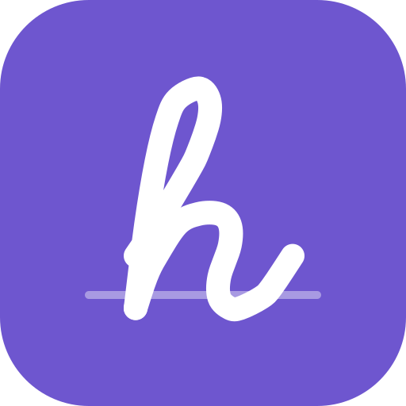

# HandNote brand guide

A small, practical system for the README, the directory listing, social images and videos.
All files are in `assets/branding/`; they are rebuilt from their sources with one command
(maintainers: `scripts/marketing/build-brand.sh`, kept in the development repository).

## Name and line

- Name: **HandNote** (one word, capital H and N). Plugin ID `handnote` (never changes).
- Line: **"Your handwriting, inside your vault."** — what the plugin does, and true: every page
  is a `.handnote` file in the user's vault.
- Short form: **"Handwriting for Obsidian"** (video thumbnail, small spaces).
- Always "for Obsidian", never a name that sounds official ("Obsidian HandNote", "Obsidian Ink").
  HandNote is an independent community plugin; do not use Obsidian's logo or its purple crystal.

## Mark

| File | Use |
|---|---|
| `icon-option-a.svg` (recommended), `png/icon-{512,256,128,64}.png` | app-style icon: a handwritten "h" on a ruled line, white on violet |
| `logo-wordmark-light.svg`, `png/wordmark-light.png` | icon + "HandNote" for light backgrounds |
| `logo-wordmark-dark.svg`, `png/wordmark-dark.png` | icon + "HandNote" for dark backgrounds |
| `icon-option-b.svg`, `icon-option-c.svg` | alternatives that were considered (see below) — not in use |

The "h" is a real pen stroke: the letter h of the Hershey script font (public-domain stroke data
by A. V. Hershey), smoothed. The wordmark text is Inter Display SemiBold converted to outlines,
so the SVG looks the same without the font installed.

Icon options compared (64 px and smaller is where they differ):

| Option | Look | At 16–32 px | Verdict |
|---|---|---|---|
| A — violet tile, white "h", ruled line | strong, simple | still reads as "h" | **recommended** |
| B — paper tile, ruled lines, violet "h" | notebook-like, friendly | lines turn into noise, pale tile disappears on white | good for large illustrations only |
| C — violet tile, dashed lasso loop around "h" | tells the lasso story | dashed loop becomes speckle | not recommended |

Rules: keep clear space of ¼ of the icon width around it; do not recolour the "h", add
shadows, outlines or gradients, rotate, or put the icon on a busy photo. Minimum size 16 px
(icon), 96 px wide (wordmark).

Note: Obsidian's community directory currently shows no custom plugin icons; these files are for
GitHub, social images and videos. Nothing in the directory listing was changed.

## Colours

| Token | Hex | Use | Contrast |
|---|---|---|---|
| Violet | `#6E56CF` | icon tile, accents, bullet dots, highlight in dark images | white on violet 5.4 : 1, violet on paper 5.2 : 1 (AA) |
| Violet dark | `#5746AF` | pressed / hover states, small text on white | white on it 7.2 : 1 |
| Ink | `#1F2328` | headlines and text on light | 15.1 : 1 on paper |
| Muted | `#57606A` | secondary text on light | 6.1 : 1 on paper |
| Paper | `#FBFAF7` | light background | — |
| Rule | `#E6E9EE` (light) / `rgba(255,255,255,.055)` (dark) | ruled-paper lines in backgrounds | decorative |
| Highlighter | `#F5D76E` | marker swash behind one key word (light images only) | decorative |
| Night | `#16151B` | dark background | `#F3F2F7` text 16.3 : 1, `#A9A6B8` muted 7.6 : 1 |

The violet is close to, but deliberately not the same as, Obsidian's default accent.

## Type

| Font | Use | Licence |
|---|---|---|
| Inter Display SemiBold / Bold | wordmark, headlines | SIL OFL 1.1 (rsms.me/inter) |
| Inter Regular / Medium | body text, captions, subtitles | SIL OFL 1.1 |
| Noto Sans CJK SC | Chinese text in images and subtitles | SIL OFL 1.1 (Google / Adobe) |

No commercial fonts. Headlines: tight tracking (−2.5 %), line height 1.04. Body: 1.4.

## Imagery

- **Only real screenshots and recordings** of the released public plugin in a clean demo vault
  (no personal notes, account names, paths or keys). See `FEATURE_CHECKLIST.md` (internal) for what
  may be claimed.
- Demo handwriting on desktop is played back from stroke data (Hershey script, Make Me a Hanzi
  medians) and must be labelled as such in videos; Apple Pencil appears only in real iPad footage.
- Background motif: faint ruled paper fading to the right; one yellow marker swash per image, no
  more.
- Screenshots sit in a rounded window (radius 14 px at 1280 px) with a soft shadow; they may bleed
  off the right edge.

## Files

| File | Size | Purpose |
|---|---|---|
| `hero-light.png`, `hero-dark.png` | 1920 × 840 | README banner (a `<picture>` picks one by colour scheme) |
| `social-preview.png` | 1280 × 640, 116 KB | GitHub social preview (upload by hand: Settings → General → Social preview) |
| `video-thumbnail.png` | 1920 × 1080 | video cover |
| `src/brand.html` | — | layout source for the three images above (variant in the URL hash) |
| `src/shot-convert.png` | 1200 × 946 | crop of a real 0.8.1 screenshot used in those images |
