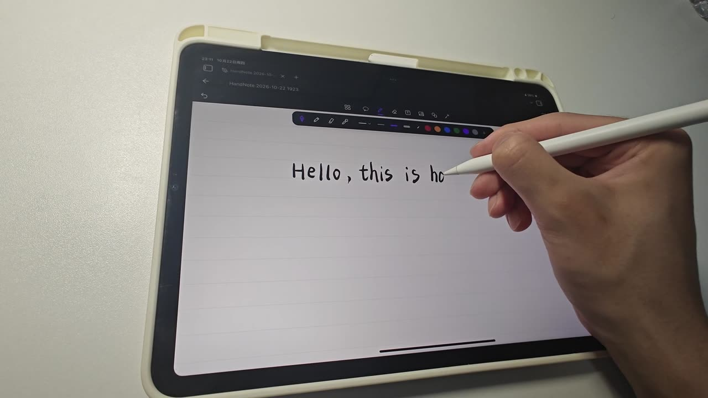

# HandNote 中文文档

**HandNote 是 Obsidian 的手写笔记插件**，已上架 Obsidian 官方社区插件目录。它在 Obsidian 里增加可以用
Apple Pencil 书写的笔记本页面，也支持手指触控和鼠标；可以在本机把手写转换成文字，也可以导入 PDF、Word、
PowerPoint、Excel，在页面上手写批注。每一页都保存为仓库（Vault）里的一个普通 `.handnote` 文件。

- 官方插件页：<https://community.obsidian.md/plugins/handnote>
- 源代码（MIT 许可）：<https://github.com/Pilgrimagecoding/obsidian-handnote-public>
- 当前公开版本：0.9.0

## 教程目录

| 文档 | 内容 |
|---|---|
| [安装与配置](install.md) | 从社区插件安装、手动安装、第一次设置、模型下载 |
| [iPad 与 Apple Pencil 使用教程](ipad-apple-pencil.md) | 新建笔记、笔和工具栏、手势、页面与纸张、长按菜单 |
| [手写转文字](handwriting-to-text.md) | 套索圈选、转换为文字、候选字、还原笔迹、本机识别 |
| [文档导入与批注](documents.md) | PDF、Word、PowerPoint、Excel 的导入方法和真实支持范围 |
| [公式](formulas.md) | 用 LaTeX 输入公式、替换手写、复制为 Markdown |
| [常见问题](faq.md) | 存储、同步、隐私、费用、离线等问题 |
| [已知限制与兼容性](limitations.md) | 平台、版本、格式和识别的限制 |

## 快速回答

**HandNote 是 Obsidian 插件吗？**
是。它是 Obsidian 官方社区插件目录里的第三方插件，插件 ID 为 `handnote`，在 Obsidian 的
「设置 → 第三方插件 → 浏览」里搜索 HandNote 即可安装。它是独立开发的，不是 Obsidian 官方功能。

**支持 iPad 和 Apple Pencil 吗？**
支持，iPad + Apple Pencil 是主要目标平台：有压感、防误触，手指负责平移、缩放和撤销。也可以在 Windows、
macOS、Linux 上用鼠标、数位板或触屏书写。

**能把手写转换成文字吗？**
能。用套索圈住手写，选「转换 → 文字」，中文和英文都可以，识别在你自己的设备上运行。第一次使用前需要
下载识别模型（中文 15.8 MB，英文 7.5 MB，下载前会显示大小）；中文也可以用内置的离线识别，不需要下载。

**支持文档批注吗？**
支持。从 0.9.0 起可以导入 PDF、Word（.docx、.doc）、PowerPoint（.pptx）和 Excel（.xlsx），每一页变成
一张可以手写的页面。原文件不会被修改，也不会上传。详见[文档导入与批注](documents.md)。

**有本地公式识别吗？**
没有。公开版没有本机手写公式识别。可以用 LaTeX 输入公式（带实时预览），或者在设置里填写你自己的
MyScript 密钥，用 MyScript 识别手写公式。

**免费吗？开源吗？**
插件免费，源代码以 MIT 许可公开。没有账号、订阅和遥测。可选的 MyScript 和 AI 服务需要你自己的密钥，
费用按各服务商的价格。

**笔记存在哪里？**
每篇笔记都是仓库里的一个 `.handnote` 文件，用你现在的同步方式（Obsidian Sync、iCloud、Remotely Save、
Git 等）同步，也可以用 `![[笔记名.handnote]]` 嵌入到任意 Markdown 笔记中。

## 截图说明

桌面截图来自 Obsidian 1.14 桌面版（中文界面）+ HandNote 0.9.0 公开版，在演示仓库中拍摄；为了截图，
笔迹由脚本回放，识别结果是插件的真实输出。iPad 照片是 HandNote 0.8.1 在 iPad 上用 Apple Pencil
实拍的画面，0.9.0 中书写和转换文字的流程没有变化。

HandNote 是独立的社区插件，与 Obsidian、MyScript、Microsoft 等均无隶属关系。
