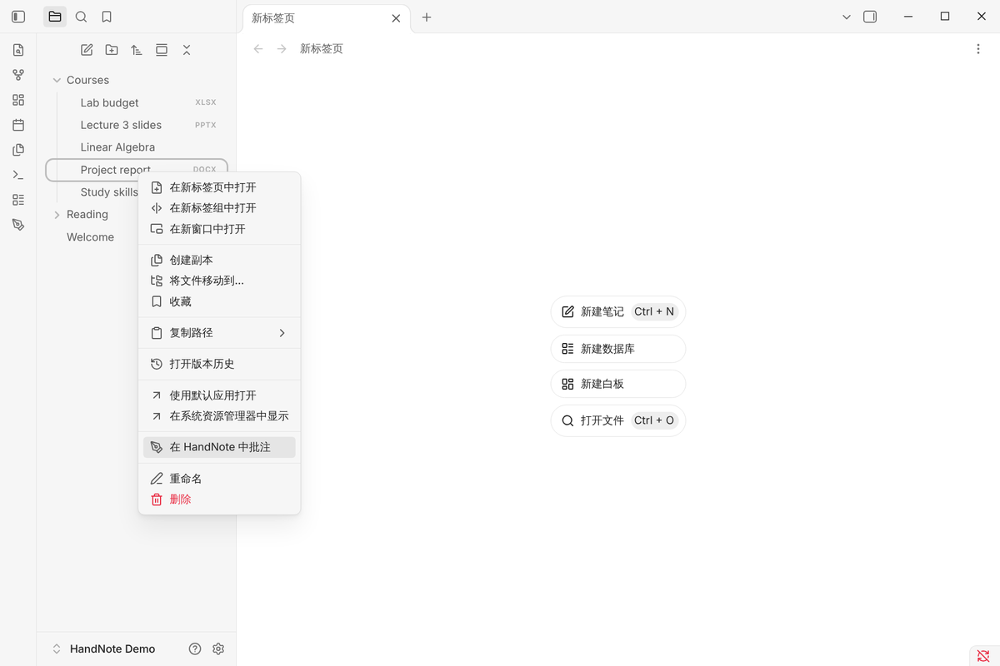
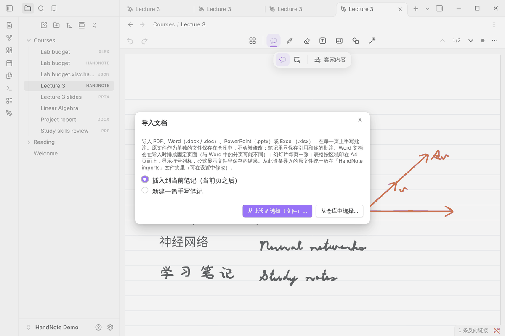
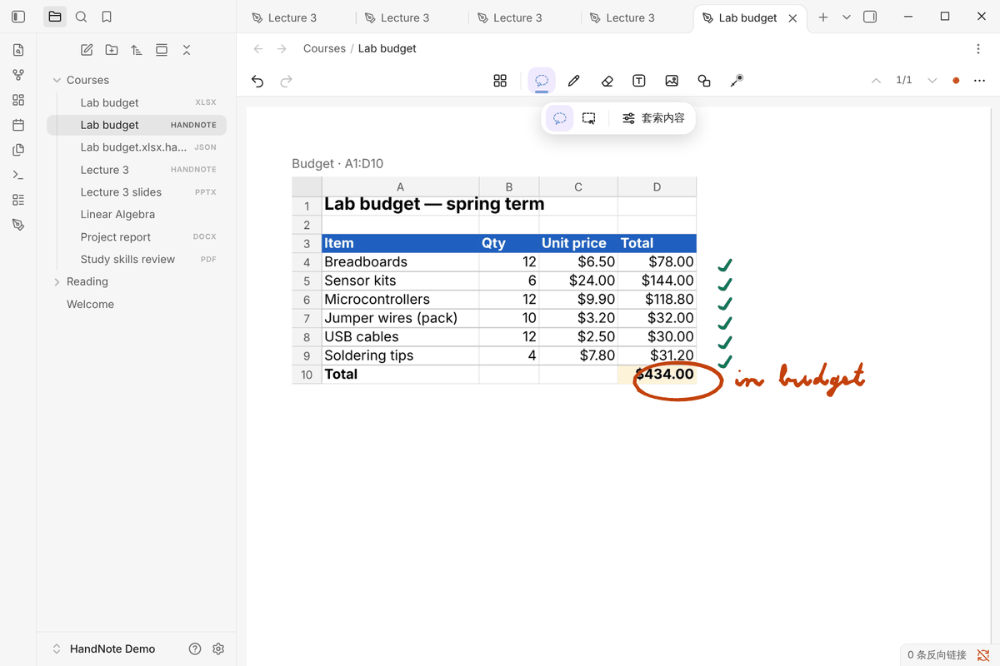

# 文档导入与批注（PDF / Word / PowerPoint / Excel）

[← 中文文档首页](README.md)

从 HandNote 0.9.0 起，可以把 PDF、Word、PowerPoint、Excel 导入为 HandNote 页面，在上面用 Apple Pencil、
手指或鼠标批注。文档的每一页变成一张同样大小的页面，原文件保持不变。

## 支持的格式

| 格式 | 支持情况 |
|---|---|
| PDF（.pdf） | 用 Obsidian 自带的 PDF 引擎按需渲染，每个 PDF 页面一页 |
| Word（.docx） | 导入时排成固定页面：标题、段落样式、列表、表格（列宽、合并单元格、边框）、图片、横向分节 |
| Word 97–2003（.doc） | 简化支持：文字、样式、表格；图片和列表编号暂不显示 |
| PowerPoint（.pptx） | 每张幻灯片一页：背景、母版和版式、占位符、项目符号、常见形状、图片（裁剪、旋转）、组合、表格 |
| Excel（.xlsx） | 像 OneNote 一样印在 A4 纸上（列多时横向），单元格保持原大小，显示数字格式、填充、边框、合并单元格、图片；**公式显示文件里保存的结果，HandNote 不会重新计算** |
| 旧版 .ppt / .xls、Pages / Keynote / Numbers、OpenDocument、带密码的文件 | 不支持；导入时会说明原因和办法（例如「另存为 .pptx 或 PDF」） |
| 带宏的 .docm / .pptm / .xlsm | 拒绝导入；宏永远不会运行 |

单个文件最大 200 MB。

**不会显示的内容**：Word 的页眉页脚、脚注、文本框、图表、公式；PowerPoint 的动画、图表、SmartArt、视频、阴影效果；
Excel 的图表和条件格式。导入时会列出这份文件里有哪些内容没有显示。

## 导入方法

**方法一：右键「在 HandNote 中批注」**

在文件列表里对 PDF / Word / PowerPoint / Excel 文件右键（iPad 上长按）→ **在 HandNote 中批注**，会新建一篇同名的
手写笔记。

> 文件列表里看不到 .docx / .pptx / .xlsx？打开 Obsidian 的 **设置 → 文件与链接 → 检测所有类型文件**。
> PDF 默认就会显示。

**方法二：「导入文档…」**

在手写笔记里点 ⋯ → **导入文档…**，或在命令面板运行
「Import document (PDF, Word, PowerPoint, Excel) for annotation」。可以选择：

- **插入到当前笔记（当前页之后）**，或 **新建一篇手写笔记**；
- **从此设备选择（文件）…**：iPad 上从「文件」App 选择，可以一次选多个文件，按选择的顺序导入；
- **从仓库中选择…**：选择仓库里已有的文件。

## 批注

导入后的页面和普通页面一样：用笔、荧光笔、文本框、图形、套索都可以，撤销、导出 PNG、嵌入 Markdown 也照常可用。

## 文件放在哪里

- **从设备选择的文件**：原文件复制一份到仓库的 `HandNote imports` 文件夹（可在 **设置 → HandNote → Imported documents**
  里修改；留空表示用 Obsidian 的附件位置）。同一个文件再次导入不会重复复制。
- **仓库里已有的文件**：直接引用，不移动、不复制。
- **笔记里保存什么**：只保存对原文件的引用和你的批注，不会把文档内容复制进笔记。
- **排版文件**：Word、PowerPoint、Excel 旁边会多一个 `<文件名>.handnote-layout.json`（较大时为 `.json.gz`），
  保存 HandNote 计算好的固定排版，保证所有设备上页面完全一致。**请让同步工具同步它**；如果缺失，HandNote 会重新排版并提示你。
- **改名、移动**：原文件改名或移动后，HandNote 会跟着找到；原文件被删除时，你的批注仍然保留。

## 安全与隐私

- 原文件永远不会被修改。
- 宏不会运行，远程图片和链接不会加载。
- 不上传任何文件，排版完全在你的设备上完成。

## 兼容性

含导入页面的笔记以文件格式 6 保存。HandNote 0.8.x 只能只读打开这些笔记，请在所有编辑它们的设备上更新到 0.9.0。
不含导入页面的笔记，保存格式和以前一样。

## 常见问题

- **iPad 上导入失败，提示文件是空的**：iCloud、百度网盘等云盘里的文件可能还没下载到本机。先在「文件」或云盘 App 里打开
  一次（或设为离线可用），再导入。
- **Word 的分页和 Word 里不一样**：HandNote 不用 Office，而是自己排版，分页、字体和换行可能略有差别。
- **Excel 的公式结果不对**：HandNote 显示的是文件里最后保存的计算结果。在 Excel / WPS 里重新计算并保存后再导入。
