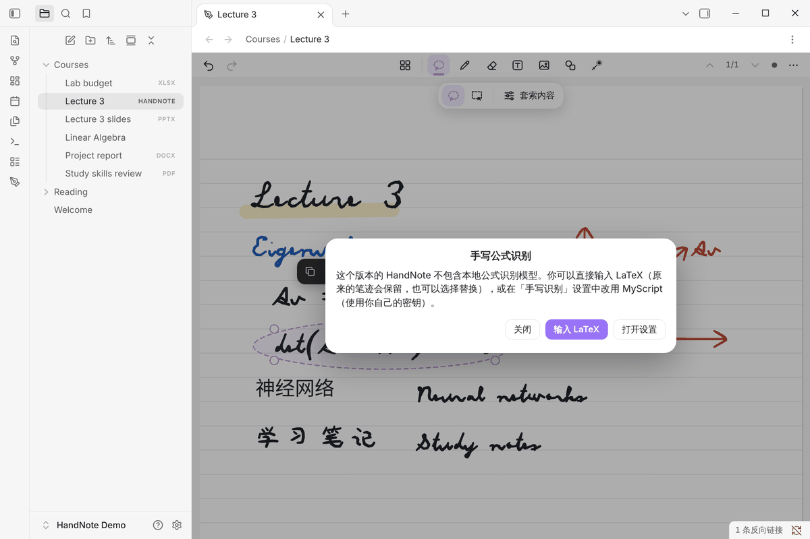
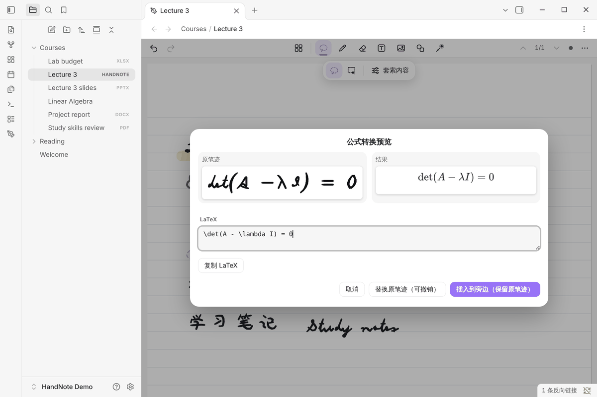

# 公式

[← 中文文档首页](README.md)

HandNote 公开版**没有本机手写公式识别**。公式可以用两种方式放进页面：自己输入 LaTeX（不联网），或者用你自己的
MyScript 密钥识别手写公式（联网）。

## 用 LaTeX 输入公式

1. 用套索圈住手写的公式，点 **✦（转换）→ 公式**。
2. 没有配置 MyScript 时，会提示「这个版本的 HandNote 不包含本地公式识别模型」，点 **输入 LaTeX**。

   

3. 在 LaTeX 框里输入公式，右边会实时显示渲染效果，左边是你圈选的原笔迹。
4. 选择：
   - **插入到旁边（保留原笔迹）**；
   - **替换原笔迹（可撤销）**；
   - **复制 LaTeX**（复制为 `$$…$$`，可以直接粘贴到 Markdown 笔记里）。

## 公式对象

插入的公式是可编辑的对象：

- 用套索选中后可以移动、缩放、复制；
- 再次编辑会回到 LaTeX 编辑框；
- 复制到 Markdown 时得到 `$$…$$`。

公式用 Obsidian 自带的数学渲染显示。用任何版本的 HandNote 创建的公式，在公开版里都能正常打开、编辑、移动和导出。

## 用 MyScript 识别手写公式（可选）

1. 在 [developer.myscript.com](https://developer.myscript.com) 注册，获得 Application key 和 HMAC key。
2. 在 **设置 → HandNote → 手写识别** 里填写密钥（保存在 Obsidian 的密钥存储中）。
3. 之后「转换 → 公式」会把所选笔迹的坐标发给 MyScript 识别（发送前确认），结果同样以 LaTeX 公式插入。

MyScript 是第三方服务，按 MyScript 的条款和价格计费。

## 为什么没有本机公式识别

目前没有找到许可条款清楚、可以随插件公开发布的手写公式识别模型，所以公开版不包含。这一点在插件页、README 和
FAQ 里都有说明。
