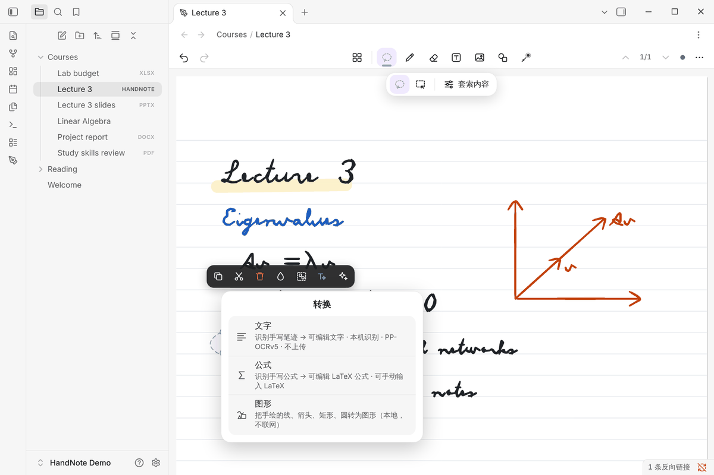
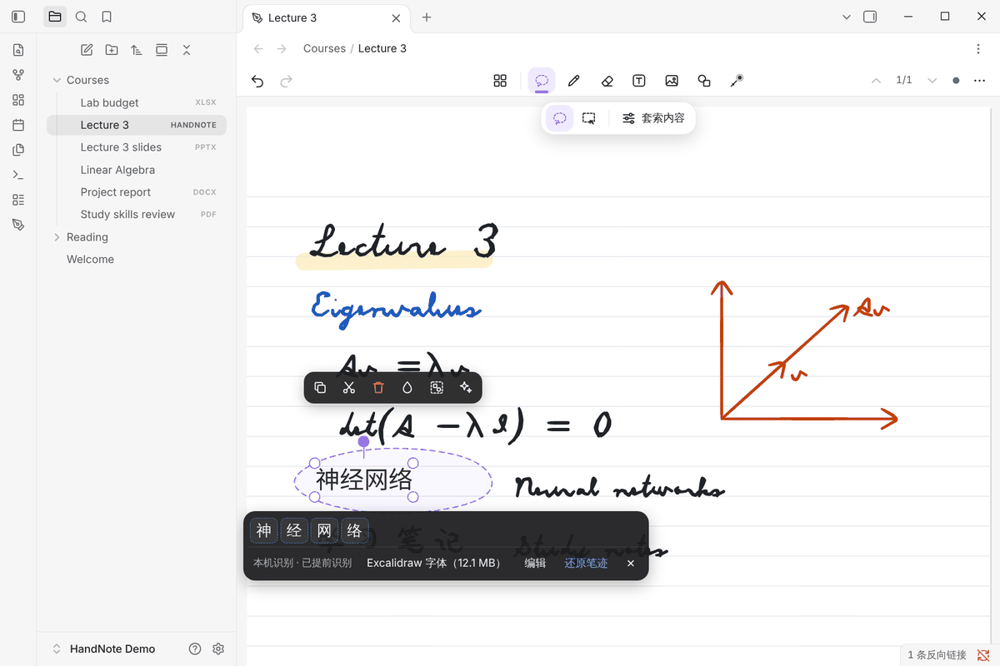
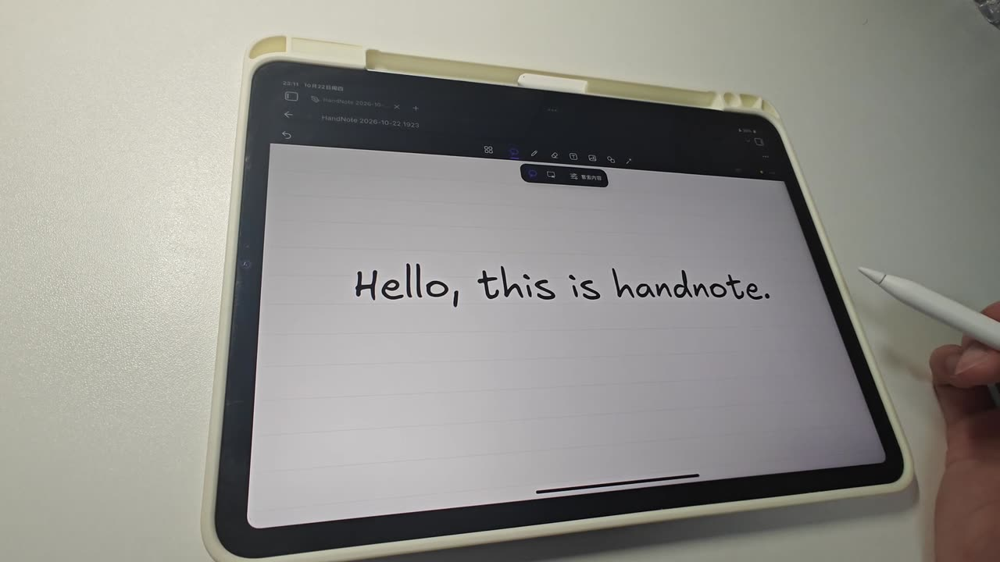

# 手写转文字

[← 中文文档首页](README.md)

HandNote 可以把手写的中文和英文转换成可编辑的文字，结果直接放在原来的位置。识别在你自己的设备上运行，
不需要账号和 API Key，笔迹不会上传。

## 步骤

1. 选择 **套索**，圈住要转换的手写。
2. 点套索工具条最右边的 **✦（转换）**，在菜单里选 **文字**。

   

3. 手写被替换成文字。下方的条上显示每个字，**虚线框的字可以点开选候选**；条上还有「编辑」和「还原笔迹」。

   

4. 不满意可以点 **还原笔迹**，或者直接撤销（转换是一步撤销）。

iPad 上的流程完全相同：

## 识别用的是什么

| 引擎 | 是否联网 | 适合 | 怎么开启 |
|---|---|---|---|
| 本地中文文字识别（PaddleOCR PP-OCRv5 移动版，15.8 MB） | 只在下载时联网 | 中文、中英混合 | 设置 → HandNote → 本地识别 → 下载；或第一次转换时按提示下载 |
| 本地英文文字识别（PP-OCRv5 英文版，7.5 MB） | 只在下载时联网 | 英文 | 同上；拉丁字母书写的行会自动使用它 |
| 离线中文识别（内置约 9500 个汉字的笔画模板） | 不联网 | 工整的中文；连笔、英文、数字效果差 | 默认开启：设置 → HandNote → 手写识别 |
| MyScript（可选） | 联网 | 多语言文字和公式 | 填写你自己的 MyScript 开发者密钥；每次发送前确认 |

本地模型保存在这台设备的应用存储里，下载后断网也能识别。模型文件有固定的大小和 SHA-256，不一致就丢弃；
不会自动更新，也不会在后台下载。

转换条上的「本机识别 · 已提前识别」表示结果来自本机模型，并且在你打开转换菜单时已经开始识别，所以点「文字」
后几乎立刻出结果。

## 转换方式

在 **设置 → HandNote → 手写识别** 里：

- **转换方式**：「直接转换（推荐）」立即替换原笔迹；「先预览再插入」会先在对话框里显示结果，确认后再插入。
- **直接转换时保留原笔迹**：打开后，结果放在原笔迹旁边，原笔迹不删除。

## 转换后的文字

- 文字是普通的文本对象，可以用文本工具或套索轻点后编辑、移动、缩放、改颜色。
- 用套索只圈住其中几个字，可以单独选中它们。
- 转换条上可以把字体换成 Excalidraw 手写字体（需要另外下载，最多 12.1 MB），让文字保持手写风格。

## 提高准确率

- 字写大一点，一行只写一种文字。
- 英文请先下载英文模型。
- 工整中文用离线识别就够；连笔字建议下载本地中文模型。
- 不确定的字会显示虚线框和候选，在你确认之前不会悄悄替换。

## 不能识别的内容

- **手写公式**：公开版没有本机公式识别，选「转换 → 公式」时会提示你直接输入 LaTeX，或改用 MyScript。见[公式](formulas.md)。
- **图片里的文字**、**思维导图 / 流程图**：需要在 **设置 → HandNote → AI** 里配置你自己的 AI 服务，发送前会确认。

## 隐私

本机识别不上传笔记和笔迹。下载模型时只是普通的文件请求，会先发几个很短的请求，找出能连上的下载源（PaddleOCR
官方、Hugging Face、hf-mirror.com 等）。详见仓库里的 [PRIVACY.md](../../PRIVACY.md)。
