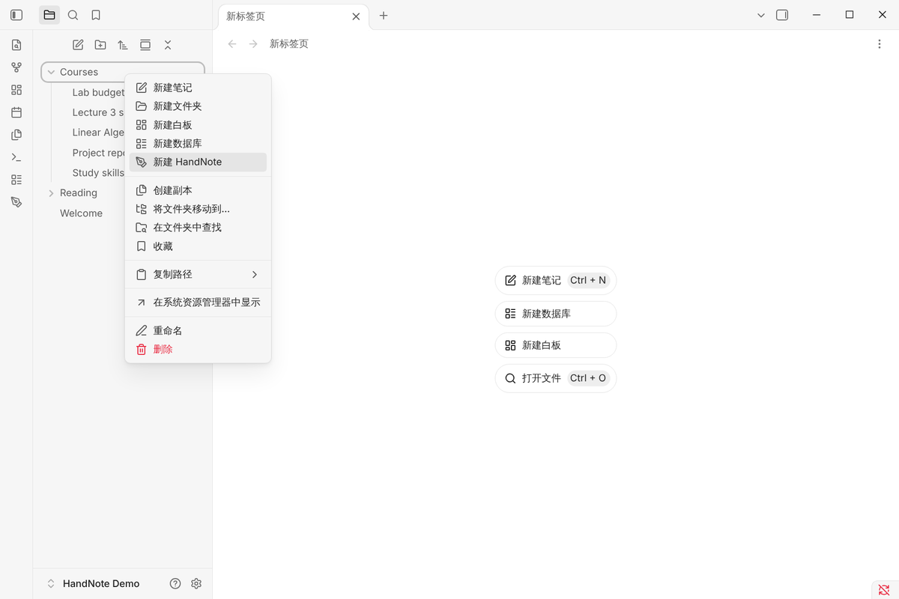
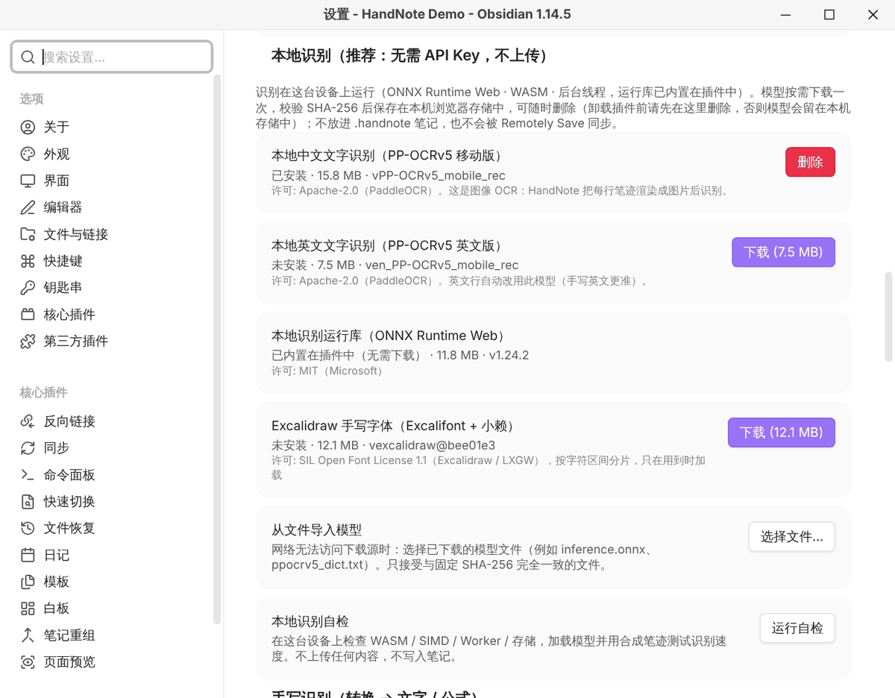
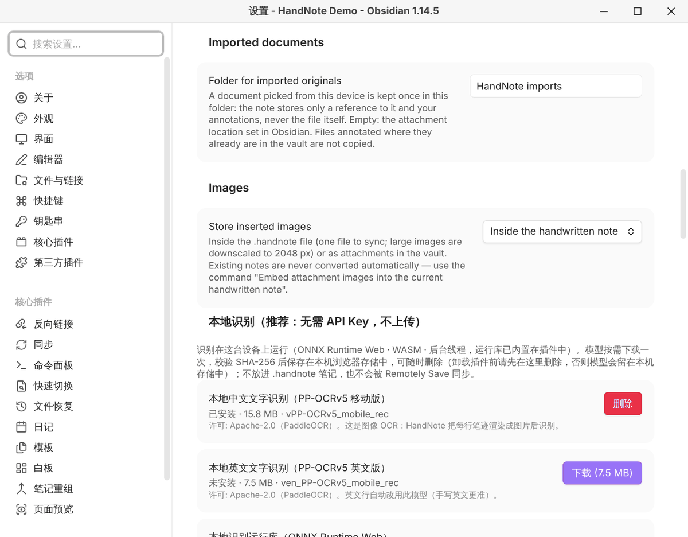

# 安装与配置

[← 中文文档首页](README.md)

HandNote 是 Obsidian 官方社区插件目录里的插件，在 Obsidian 内直接搜索安装即可。桌面版和 iPad 版的安装
方法相同。

## 要求

- Obsidian 1.11.4 或更高版本。
- iPad / iPhone 上的本机文字识别需要 iPadOS / iOS 16.4 或更高版本（更旧的系统也能书写，只是不能用本机识别）。

## 从社区插件目录安装（推荐）

1. 打开 Obsidian 的 **设置 → 第三方插件**。如果是第一次使用第三方插件，先关闭「安全模式」。
2. 点 **浏览**，搜索 **HandNote**。
3. 点 **安装**，再点 **启用**。

也可以在电脑浏览器里打开 [官方插件页](https://community.obsidian.md/plugins/handnote)，点 **Add to Obsidian**。

## 手动安装

1. 从 [GitHub 最新版本](https://github.com/Pilgrimagecoding/obsidian-handnote-public/releases/latest) 下载
   `main.js`、`manifest.json`、`styles.css` 三个文件。
2. 放进 `<你的仓库>/.obsidian/plugins/handnote/` 文件夹（没有就新建）。
3. 在 **设置 → 第三方插件** 里启用 HandNote。

每个文件的 SHA-256 写在版本说明里，版本还附有 GitHub 构建来源证明（attestation），可以用来核对下载的
文件是否完整。

> 使用 Obsidian Sync 标准版时注意：`main.js` 约 6.2 MB（识别运行库内置在插件里），标准版不同步超过 5 MB
> 的文件。请在每台设备上分别从社区插件目录安装 HandNote，笔记本身照常同步。

## 新建第一篇手写笔记

- 在文件列表的文件夹上右键 → **新建 HandNote**；
- 或者在命令面板运行 **New handwritten note**（新建手写笔记）。

默认放在当前打开的笔记旁边。可以在 **设置 → HandNote → New notes → Folder for new handwritten notes**
里指定专门的文件夹（不要用 `_` 或 `.` 开头的文件夹，Remotely Save 默认会跳过它们），并设置新笔记默认的
纸张大小（Paper size）和页面背景（Page background：空白、横线、方格、点阵）。

## 可选：下载识别模型

书写、套索、导入文档、LaTeX 公式都不需要下载任何东西。只有「转换 → 文字」要用到识别模型。

打开 **设置 → HandNote → 本地识别**：

| 识别包 | 大小 | 用途 |
|---|---|---|
| 本地中文文字识别（PP-OCRv5 移动版） | 15.8 MB | 中文和中英混合 |
| 本地英文文字识别（PP-OCRv5 英文版） | 7.5 MB | 英文 |
| Excalidraw 手写字体（可选） | 最多 12.1 MB，按字符加载 | 让转换后的文字保持手写风格 |

点 **下载** 才会下载，下载前会显示大小。模型保存在这台设备的应用存储里，不进仓库，也不会被同步，每台设备
各下载一次。不下载模型时，中文也可以用内置的「离线中文识别」（默认开启，适合工整的中文）。

网络连不上下载源时，可以在电脑上下好模型文件，再用 **从文件导入模型** 导入；只接受 SHA-256 与插件内置
记录完全一致的文件。**运行自检** 会显示这台设备支持哪些功能、哪些下载源能连上。

## 可选：导入文档的存放位置

从设备里选择的 PDF / Word / PowerPoint / Excel 原文件，会复制一份到仓库的 `HandNote imports` 文件夹。
可以在 **设置 → HandNote → Imported documents → Folder for imported originals** 里修改；留空表示使用
Obsidian 的附件位置。已经在仓库里的文件会直接引用，不会再复制。

## 可选：MyScript 和 AI 服务

这两项都默认关闭，只有你自己填写密钥后才会联网：

- **MyScript**（设置 → HandNote → 手写识别）：用你自己的 MyScript 开发者密钥识别手写文字和公式。每次发送前会
  确认，只发送所选笔迹的坐标。
- **AI 服务**（设置 → HandNote → AI）：OpenAI、Anthropic、Google Gemini、DeepSeek、阿里云百炼 Qwen 或任意
  OpenAI 兼容接口，用于把草图整理成思维导图、流程图，或识别图片里的文字。确认后发送所选区域的图片。

密钥保存在 Obsidian 的密钥存储中，不会写进设置文件或笔记。费用按服务商的价格。

## 下一步

- [iPad 与 Apple Pencil 使用教程](ipad-apple-pencil.md)
- [手写转文字](handwriting-to-text.md)
