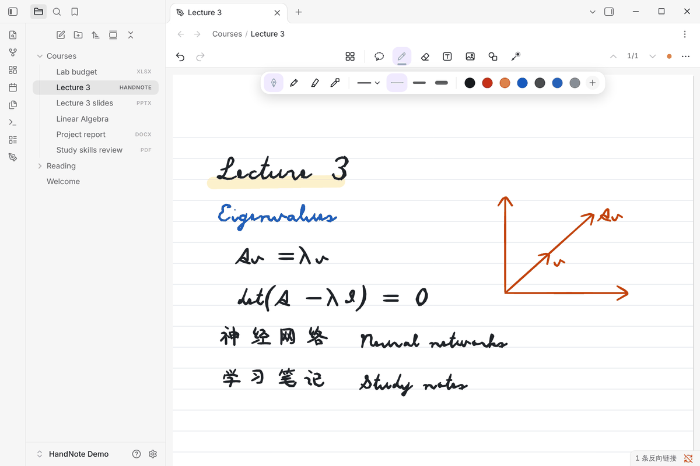
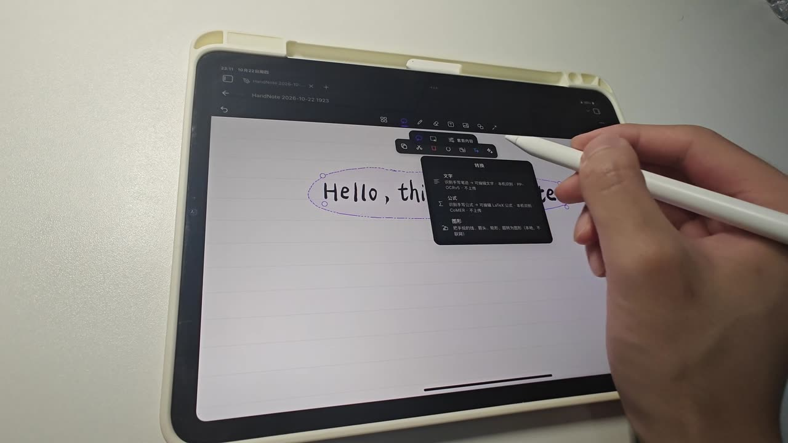
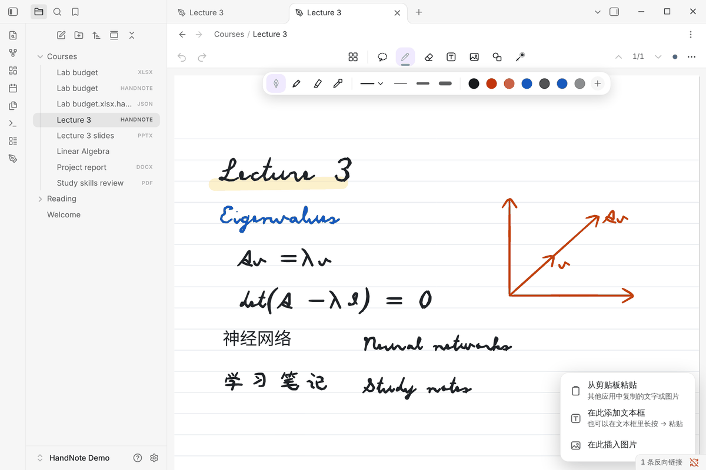
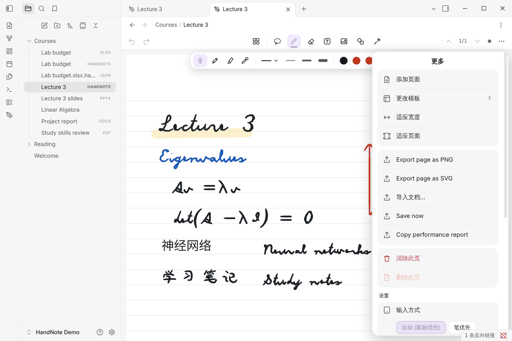
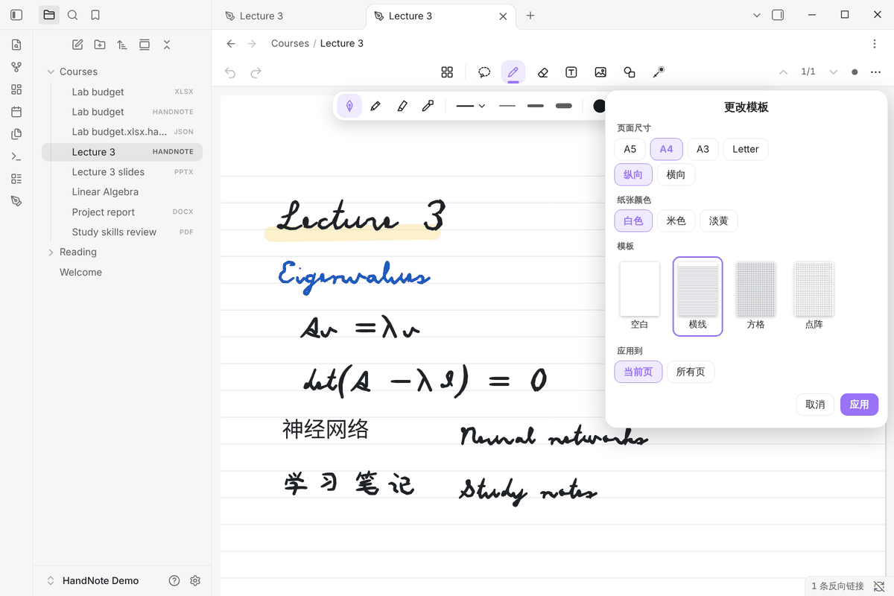
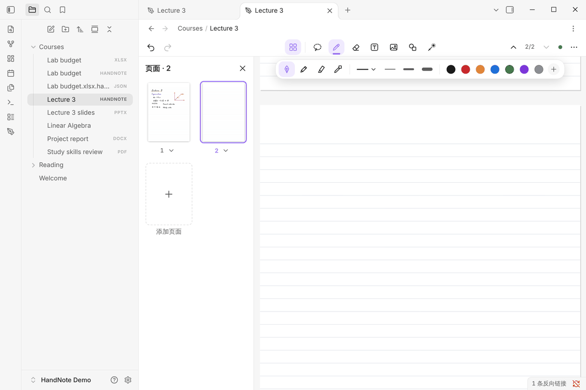

# iPad 与 Apple Pencil 使用教程

[← 中文文档首页](README.md)

在 iPad 上，HandNote 的分工是：**Apple Pencil 书写，手指操作**。用 Pencil 写字、画图、圈选，用手指平移、
缩放、撤销和调出菜单；手掌搭在屏幕上不会留下笔迹。

## 1. 安装并新建笔记

1. 在 iPad 版 Obsidian 中：**设置 → 第三方插件 → 浏览**，搜索 HandNote，安装并启用（详见[安装与配置](install.md)）。
2. 在文件列表里长按一个文件夹 → **新建 HandNote**，或者在命令面板运行 **New handwritten note**。
3. 新笔记会直接打开，拿起 Pencil 就可以写。

HandNote 笔记是仓库里的 `.handnote` 文件。用 iCloud、Obsidian Sync、Remotely Save 等同步仓库时，笔记会和
其他文件一起同步到电脑上，在桌面版 Obsidian 里也能打开和编辑。

## 2. 工具栏

顶部工具栏从左到右：

| 位置 | 按钮 |
|---|---|
| 左侧 | 撤销、重做 |
| 中间 | 页面、套索、笔、橡皮擦、文本、图像、图形、激光笔 |
| 右侧 | 上一页 / 下一页、页码、保存状态、更多（⋯） |

选中笔以后，工具栏下方会出现笔选项：钢笔、铅笔、荧光笔等笔型，线型（实线、虚线），粗细和颜色。钢笔和铅笔有
压感，可以在笔设置里调整压力敏感度、笔尖锐度和防抖。形状笔会把画出的直线、箭头、圆和矩形自动变规整。

## 3. 手势

| 操作 | Apple Pencil | 手指 |
|---|---|---|
| 书写 | 直接写 | —（除非在设置里打开「Finger drawing」） |
| 平移 / 缩放 | — | 单指拖动 / 双指捏合 |
| 撤销 / 重做 | — | 双指轻点 / 三指轻点 |
| 编辑文字 | 用套索或文本工具轻点它 | 轻点它 |
| 笔 ⇄ 橡皮擦 | — | 单指双击 |
| 粘贴、在此添加 | — | 长按页面 |

这些都可以在 **设置 → HandNote → Input** 里调整。「Input mode on this device」默认是 Auto：iPad 上笔优先，
电脑上鼠标优先；这项设置只保存在本设备，不写进笔记。

## 4. 套索：选择、移动、转换

选择套索，用 Pencil 圈住要处理的内容。圈中后可以：

- 拖动移动，拉角点缩放、旋转；
- 在套索工具条上复制、剪切、删除、改颜色；
- 点 **转换**（✦ 按钮）：把手写变成文字、公式或规整的图形。

转换文字的完整步骤见[手写转文字](handwriting-to-text.md)。

## 5. 手指长按菜单（0.9.0 新增）

用手指在页面上长按约半秒，会弹出菜单：

- **粘贴**：粘贴在 HandNote 里复制的笔迹或对象（复制过才会出现）；
- **从剪贴板粘贴**：粘贴其他 App 里复制的文字或图片；
- **在此添加文本框**；
- **在此插入图片**。

Apple Pencil 不受影响，长按不会打断书写。iPadOS 在 App 读取剪贴板时会弹出系统的「粘贴」确认，这是系统行为。
桌面版用右键打开同一个菜单，也可以直接按 Ctrl+V。

## 6. 页面、纸张和模板

- **加页面**：⋯ → **添加页面**，或在页面侧栏里点「添加页面」。
- **页面侧栏**：工具栏中间的页面按钮，显示所有页的缩略图，可以拖动排序。
- **更改模板**：⋯ → **更改模板**，可以选页面尺寸（A5、A4、A3、Letter）、纵向或横向、纸张颜色（白色、米色、淡黄），
  以及空白、横线、方格、点阵模板；可以只改当前页，也可以应用到所有页。

## 7. 在 Markdown 笔记里引用手写页面

在任意 Markdown 笔记里写 `![[Lecture 3.handnote]]`，就能把手写页面嵌入进来，和普通的 Obsidian 嵌入一样。
双链、反向链接、搜索文件名都照常可用。

## 8. 导出

⋯ → **Export page as PNG** 或 **Export page as SVG**，或者在命令面板运行
「Export current page as PNG / SVG」，把当前页导出成图片。

## 常见问题

- **字迹有延迟或断笔**：先确认 Obsidian 和 iPadOS 是最新版本；在 **设置 → HandNote → Input** 里可以换用
  「Fountain pen variant」，或打开「Predicted ink (experimental)」。
- **手掌留下了笔迹**：检查「Finger drawing」是否被打开了；打开后手指也会书写。
- **iPhone 能用吗**：插件没有使用桌面专用接口，但手机没有测试过，工具栏是按平板和电脑设计的。

更多问题见[常见问题](faq.md)。
